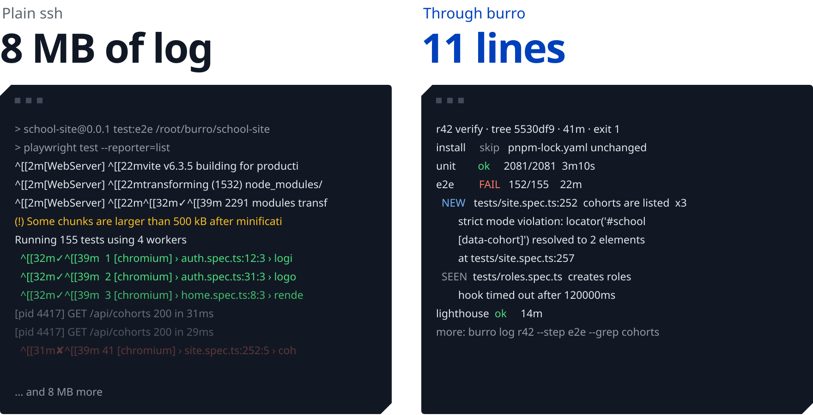
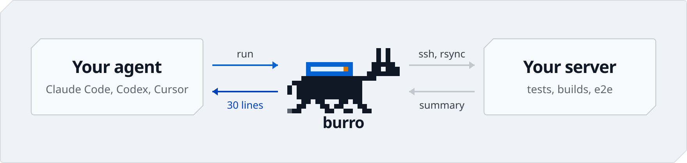

<picture>
  <source media="(prefers-color-scheme: dark)" srcset=".github/readme/hero-dark.svg">
  
</picture>

<p align="center">
  Run your coding agent's tests on your own server.<br>
  One call to start, one short summary back. Works with Claude Code, Codex and Cursor.
</p>

<p align="center">
  <a href="#install"></a>&nbsp;
  <a href="#quick-start"><picture><source media="(prefers-color-scheme: dark)" srcset=".github/readme/key-quickstart-dark.svg"></picture></a>&nbsp;
  <a href="https://github.com/timhartmann7/burro"><picture><source media="(prefers-color-scheme: dark)" srcset=".github/readme/key-star-dark.svg"></picture></a>
</p>

<p align="center">
  <a href="https://github.com/timhartmann7/burro/releases/latest"></a>
  <a href="LICENSE"></a>
  <a href="https://github.com/timhartmann7/burro/releases"></a>
</p>

<br>

<picture>
  <source media="(prefers-color-scheme: dark)" srcset=".github/readme/compare-dark.svg">
  
</picture>

<!--
  The measured number goes here: tokens the agent read on one real run of
  the same suite, once over plain ssh and once through burro, and the cost
  at the Claude Opus 5.5 API input price.
-->

Over plain ssh the agent pulls the log into its context: ANSI codes, progress bars, and the failing test somewhere in the middle. The log stays in the context and goes out again with every later turn. burro reads the log on the server and sends back what failed, where, and the command to see more.

## Install

```sh
curl -fsSL https://github.com/timhartmann7/burro/releases/latest/download/install.sh | sh
```

macOS and Linux. No sudo: the script checks the checksum and installs to `~/.local/bin`. Homebrew, `go install`, mise, aqua and ubi: [other ways to install](#other-ways-to-install).

## Quick start

**1. Add your server, once.** You need a Linux server on amd64 or arm64 with `rsync` and `bash`.

```sh
burro host add myserver root@203.0.113.10 -i ~/.ssh/id_ed25519
```

Already in `~/.ssh/config`? `burro host add myserver myserver` reuses the alias. burro never accepts a host key on its own: if you have never logged in to the server, it asks you to run `ssh` once by hand and check the fingerprint.

**2. Paste this into Claude Code, Codex or Cursor** in your project:

```text
Set up burro in this project. Run `burro init`, then fill in burro.toml:
the host from `burro host ls`, and one step per test command, each with
a JUnit report (`burro help config` lists the fields). Then run the tests
with `burro run` and `burro wait`, and fix what fails.
```

That's it. `burro init` writes a short rules block into `CLAUDE.md` or `AGENTS.md`, so from the next session on your agent runs tests through burro without being asked.

## What changes for your agent

<picture>
  <source media="(prefers-color-scheme: dark)" srcset=".github/readme/how-dark.svg">
  
</picture>

- **Two calls per run.** `burro run` starts the run and returns at once. `burro wait` blocks until it ends and prints the summary. No sleep loops, no polling the log.
- **Failures, not logs.** burro reads the JUnit reports on the server: the failed test, file and line, the first line of the error, NEW or SEEN against the last run, and the next command.
- **Exit codes are the API.** Exit 1 means fix the code. Exit 2 means the stand is broken: the agent stops and calls you instead of hacking around it with raw `ssh`.
- **Never a stale tree.** `burro run` syncs first and stamps the run with the tree hash. `node_modules` and build caches on the server survive between runs.
- **The run outlives the connection.** The runner is detached on the server. Close the lid, lose the Wi-Fi: `burro wait` picks the run up again.
- **Cleans up after itself.** Every run gets its own docker compose project, removed at the end. Secrets live in tmpfs for the run only.
- **Your server, your keys.** burro uses your own `ssh`, `rsync` and `~/.ssh/config`. No daemon, no open ports, no account, no telemetry.

burro is a pack donkey: it carries your e2e suite to the server and brings back only what the agent needs to read.

<details>
<summary><b>The rules block <code>burro init</code> writes</b></summary>

<br>

Keep your agent rules somewhere else? `burro init --print` prints the block and writes nothing.

```markdown
<!-- burro:begin -->
## Remote runs

- Tests, builds and e2e run on the burro host only, through `burro`.
  Never use raw `ssh`, `rsync` or `docker` against that host.
- Start a run with `burro run <pipeline>`. Then run `burro wait` as a
  background command and keep working. Act on its summary.
- If you can't run background commands, run `burro wait --timeout 9m`
  and repeat it while it exits with 3.
- Never poll with sleep loops.
- Need more detail: `burro log --step <name> --grep <pattern>`.
  Never print a whole log.
- One-off commands on the host: `burro exec -- <cmd>` or
  `burro exec --file <script>`. No nested quoting through ssh.
- Exit 1: fix the code. Exit 2: the stand is broken, report it and
  stop. Exit 5: a run is active, wait for it or `burro cancel`.
- Never clean docker by hand. Use `burro clean`.
- burro.toml has no test steps yet: add them from the project's test
  commands, each with a JUnit report. Field reference: `burro help config`.
- New test commands go into burro.toml with a JUnit report, not into
  ad hoc scripts.
<!-- burro:end -->
```

</details>

## FAQ

<details>
<summary><b>What do I need?</b></summary>

<br>

On your machine: macOS or Linux with `ssh`, `rsync` and `git`. On the server: Linux on amd64 or arm64 with `rsync` and `bash`, and docker only if your steps use it. The project lives in a git repository.

</details>

<details>
<summary><b>Which test runners work?</b></summary>

<br>

Any runner that writes JUnit XML: pytest, Go, Rust, PHPUnit, Maven, Gradle, Jest, Vitest, Playwright and most others. A step without a report gets the clean tail of its log in the summary instead. See [the JUnit table](#config).

</details>

<details>
<summary><b>What happens when my laptop sleeps mid-run?</b></summary>

<br>

Nothing. The run lives on the server, detached from your ssh session. Run `burro wait` again and it prints the summary when the run is done. Ctrl+C during `wait` is safe too.

</details>

<details>
<summary><b>Is it safe to point at my server?</b></summary>

<br>

burro never accepts a host key on its own and never edits `known_hosts`. Secrets travel through the stdin of `ssh`, never in arguments, live in `/dev/shm` for the run only and show up as `***` in logs. At the end of a run burro removes only that run's containers, so a cleanup can't wipe another run's database.

</details>

<details>
<summary><b>Does burro send anything anywhere?</b></summary>

<br>

No telemetry. Besides `ssh` and `rsync` to your servers, burro checks GitHub for a new version once a day, and only for a human in a terminal. The full list and how to turn it off: [Privacy](#privacy).

</details>

<br>

---

<br>

## Run it yourself

The same loop your agent runs:

```sh
burro run            # sync and start the default pipeline, returns at once
burro wait           # Ctrl+C is safe, the run keeps going
burro log --step e2e --grep login
```

`burro --help` lists every command on one screen.

## Config

`burro.toml` sits at the repository root. `burro help config` prints the field reference.

```toml
host = "myserver"             # a name from burro host ls
path = "~/burro/myapp"        # project folder on the server, default ~/burro/<repo name>

[pipelines]
default = ["install", "unit"]
verify  = ["install", "unit", "e2e"]

[steps.install]
run = "pnpm install --frozen-lockfile"
env = { NPM_CONFIG_USERCONFIG = "$BURRO_SECRETS/npmrc" }
secrets = ["npmrc"]
skip_if_unchanged = ["pnpm-lock.yaml"]

[steps.unit]
run = "pnpm vitest run --reporter=junit --outputFile=.burro/out/unit.xml"
junit = ".burro/out/unit.xml"
continue_on_fail = true
timeout = "20m"

[steps.e2e]
run = "pnpm playwright test --reporter=junit"
env = { PLAYWRIGHT_JUNIT_OUTPUT_NAME = ".burro/out/e2e.xml" }
junit = ".burro/out/e2e.xml"
timeout = "40m"

[secrets]
npmrc = "~/.npmrc"

[filters]
drop = ['^\s*$']
```

<details>
<summary><b>JUnit on your stack</b></summary>

<br>

| Stack | Step |
| --- | --- |
| Python | `pytest --junitxml=.burro/out/py.xml` |
| Go | `gotestsum --junitfile .burro/out/go.xml ./...` |
| Rust | `cargo nextest run --profile ci` with a `[profile.ci.junit]` section in `.config/nextest.toml` |
| PHP | `phpunit --log-junit .burro/out/php.xml` |
| Java, Kotlin | Maven and Gradle write JUnit themselves: `junit = "target/surefire-reports/*.xml"` or `"build/test-results/test/*.xml"` |
| Jest | the `jest-junit` reporter with `JEST_JUNIT_OUTPUT_FILE=.burro/out/jest.xml` |
| Vitest | `--reporter=junit --outputFile=.burro/out/unit.xml` |
| Playwright | `--reporter=junit` with `PLAYWRIGHT_JUNIT_OUTPUT_NAME=.burro/out/e2e.xml` |

A step without `junit` gets the clean tail of its log in the summary instead.

</details>

## Exit codes

The exit code tells the agent at once whether to fix its code or call you.

| Code | Meaning | Your agent |
| --- | --- | --- |
| 0 | All steps passed | Moves on |
| 1 | A step or a test failed | Reads the summary, fixes the code |
| 2 | The stand is broken: ssh, sync, missing `rsync`, the runner died, the host key is unknown or changed | Reports to you and stops |
| 3 | `wait` timed out or was interrupted; the run goes on | Runs `burro wait` again |
| 4 | Bad config or arguments | Fixes `burro.toml` or the command |
| 5 | Another run is active in this project | Waits or runs `burro cancel` |

Every error is one line plus a `fix:` line with the next step.

## Other ways to install

<details>
<summary><b>Homebrew, go install, mise, aqua, ubi</b></summary>

<br>

Homebrew, from the tap:

```sh
brew install timhartmann7/tap/burro
```

Since Homebrew 6 a tap outside Homebrew needs your trust before brew loads anything from it. Installing by the full name, as above, trusts only the burro cask. `brew upgrade burro` works from then on.

Go 1.27 or later:

```sh
go install github.com/timhartmann7/burro/cmd/burro@latest
```

A `go install` build carries no server binary. It downloads the one of its own version from GitHub Releases when you add a server, checks it against `checksums.txt`, and only then copies it to the server. The server never needs access to GitHub.

mise and ubi read the release archives directly:

```sh
mise use -g github:timhartmann7/burro
ubi --project timhartmann7/burro --in ~/.local/bin
```

aqua needs a registry entry; the archive names follow the plain pattern, so it has no replacements:

```yaml
packages:
  - type: github_release
    repo_owner: timhartmann7
    repo_name: burro
    asset: burro_{{.OS}}_{{.Arch}}.tar.gz
```

</details>

Every release has `checksums.txt`, a keyless cosign signature of it in `checksums.txt.sigstore.json` and a GitHub attestation.

## Docker isolation

Each run has a run key, unique on the host, in `$BURRO_RUN`. Steps get `COMPOSE_PROJECT_NAME=$BURRO_RUN`, so `docker compose` keeps the containers, networks and volumes of every run apart with no change to your project.

A step that starts containers with plain `docker run` must label them:

```sh
docker run --label burro.run=$BURRO_RUN ...
```

At the end of every run, after `burro cancel` and on `burro clean`, burro removes the run's compose project and everything labelled with its key. Nothing else on the server is touched.

## Secrets

A secret is a local file named in `[secrets]`. burro sends its contents through the stdin of `ssh`, never in arguments, and the server keeps them in `/dev/shm/burro/<run key>/` for the duration of the run only. Steps find them in `$BURRO_SECRETS`. Nothing is written to the server's disk.

Secret contents are replaced with `***` in step logs, in `exec` output and in every summary. Values shorter than 4 bytes are not masked: masking them would mask half of every log.

## Privacy

burro has no telemetry. Besides `ssh` and `rsync` to the servers you add, it makes these requests:

- Once a day, for a human in a terminal only: `GET https://api.github.com/repos/timhartmann7/burro/releases/latest`, to tell you about a newer version. Never in agent mode. `DO_NOT_TRACK=1`, `BURRO_NO_UPDATE_CHECK=1` or a non-empty `CI` turn it off.
- For a `go install` build only: the server binary and `checksums.txt` from GitHub Releases, when a server needs the binary.
- `install.sh` downloads the archive and `checksums.txt` from GitHub Releases.

<br>

<picture>
  <source media="(prefers-color-scheme: dark)" srcset=".github/readme/footer-dark.svg">
  
</picture>

<p align="center">
  <a href="https://github.com/timhartmann7/burro"><picture><source media="(prefers-color-scheme: dark)" srcset=".github/readme/key-star-dark.svg"></picture></a>
</p>

<p align="center">
  <sub>The only official repository is <code>github.com/timhartmann7/burro</code>. Apache 2.0, see <a href="LICENSE">LICENSE</a>.</sub>
</p>
